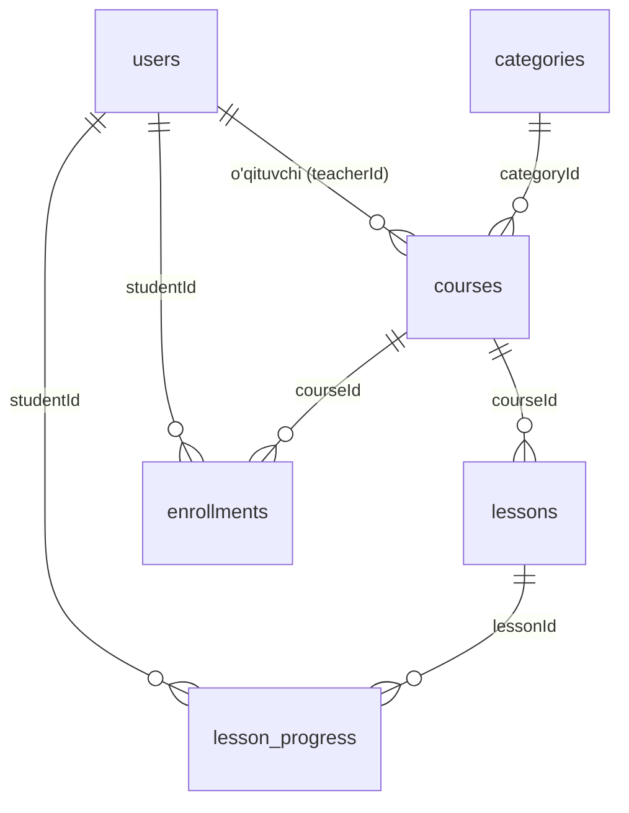

# EduLearn — kurslarga yozilish platformasi

"Web texnologiyalar" fanidan semestr yakuniy jamoaviy loyihasi (mavzu №3).

EduLearn — onlayn kurslar platformasi:

- **mehmon** kurslar katalogini ko'radi, qidiradi va filtrlaydi;
- **talaba** ro'yxatdan o'tadi, kursga yoziladi, darslarni o'qiydi va progressini kuzatadi;
- **o'qituvchi** kurs va darslar yaratadi, o'z talabalarining natijalarini ko'radi;
- **super admin** foydalanuvchilar va rollarni boshqaradi, kurslarni tasdiqlaydi, statistikani ko'radi.

Login sahifasida rol tanlash yo'q. Hamma bitta forma orqali email va parol bilan kiradi, rol esa bazadagi `role` maydonidan olinadi.

## Texnologiyalar

| Qism | Texnologiyalar |
|---|---|
| Frontend | React 19, Vite, Tailwind CSS 4, React Router, Axios, React Hook Form + Zod, Recharts, lucide-react, react-hot-toast |
| Backend | Node.js, Express 5, Prisma ORM 7, Zod, JWT (HttpOnly cookie), bcryptjs, helmet, cors, express-rate-limit |
| Ma'lumotlar bazasi | PostgreSQL. Lokalda `embedded-postgres` orqali ishlaydi, o'rnatish shart emas |
| Testlar | Vitest + Supertest (backend, 39 ta), Vitest + React Testing Library (frontend) |

## Ishga tushirish

Talab: **Node.js 20+** (24 tavsiya etiladi). PostgreSQL'ni alohida o'rnatish shart emas.

```bash
git clone <repo-havolasi>
cd <repo-papkasi>
npm run setup      # paketlar + backend/.env + baza + migratsiya + test ma'lumotlari
npm run dev        # PostgreSQL + API (3000) + frontend (5173)
```

Brauzerda **http://localhost:5173** ni oching.

| Buyruq | Nima qiladi |
|---|---|
| `npm run setup` | Birinchi marta: barcha paketlarni o'rnatadi, `backend/.env` yaratadi, bazani tayyorlaydi |
| `npm run dev` | Ishlab chiqish rejimi: baza, API va frontend birga ishga tushadi, kod o'zgarsa avtomatik yangilanadi |
| `npm run build && npm start` | Production rejim: React build qilinadi va hammasi bitta portda ochiladi — **http://localhost:3000** |
| `npm test` | Backend va frontend testlari |
| `npm run test:e2e` | 3 rol (o'qituvchi → admin → talaba) integratsiyasi testi; `npm run dev` ishlab turishi kerak |
| `npm run db:seed --prefix backend` | Bazani tozalab, test ma'lumotlarini qaytadan yuklash |
| `npm run db:studio --prefix backend` | Prisma Studio — bazani brauzerda ko'rish |

Kompyuterda o'zingizning PostgreSQL bo'lsa, `backend/.env` dagi `DATABASE_URL` ni o'zgartiring va `npm run dev --prefix backend` hamda `npm run dev --prefix frontend` ni alohida ishga tushiring.

> Windows'da PostgreSQL 16+ ning `initdb` dasturi ba'zi tizim tillarida yiqiladi (`pg_import_system_collations`). Shuning uchun lokal baza PostgreSQL 15 da ishlaydi. Prisma sxemasi 15+ ning barcha versiyalari bilan mos.

### Test hisoblari

Seed skripti quyidagi akkauntlarni yaratadi. Parollar `backend/.env` dagi `SEED_ADMIN_PASSWORD` va `SEED_DEMO_PASSWORD` dan olinadi. Standart qiymatlar faqat lokal ishlab chiqish uchun.

| Rol | Email | Parol (standart) |
|---|---|---|
| Super admin | admin@edulearn.uz | `Admin12345` |
| O'qituvchi | sardor@edulearn.uz, dilnoza@edulearn.uz, malika@edulearn.uz | `Parol12345` |
| Talaba | talaba@edulearn.uz, nodira@edulearn.uz, jamshid@edulearn.uz, sevara@edulearn.uz | `Parol12345` |

## Rollar va huquqlar (RBAC)

| Amal | Mehmon | Talaba | O'qituvchi | Super admin |
|---|:-:|:-:|:-:|:-:|
| Katalog, qidiruv, kurs sahifasi, o'qituvchilar | ✅ | ✅ | ✅ | ✅ |
| Ochiq (preview) darsni ko'rish | ✅ | ✅ | ✅ | ✅ |
| Ro'yxatdan o'tish (faqat STUDENT bo'ladi) | ✅ | — | — | — |
| Kursga yozilish / chiqish, dars tugatish, progress | — | ✅ | — | — |
| Yopiq dars matnini o'qish | — | yozilgan kursida | o'z kursida | ✅ |
| Kurs yaratish | — | — | ✅ | — |
| Kursni tahrirlash/o'chirish, dars qo'shish/tartiblash | — | — | faqat o'ziniki | ✅ |
| Kursni nashr qilish / qoralamaga qaytarish (kamida 1 dars bo'lsa) | — | — | faqat o'ziniki | ✅ |
| Kursni yashirish (ARCHIVED) | — | — | — | ✅ |
| O'qituvchi bo'lish uchun ariza yuborish | — | ✅ | — | — |
| Arizani qabul qilish / rad etish | — | — | — | ✅ |
| Kurs talabalari va ularning progressi | — | — | o'z kursida | ✅ |
| Kategoriyalar CRUD | — | — | — | ✅ |
| Foydalanuvchilar: rol berish, bloklash | — | — | — | ✅ |

- O'qituvchi rolini faqat super admin beradi.
- Super admin faqat seed orqali yaratiladi: API orqali `SUPER_ADMIN` rolini berib bo'lmaydi.
- Admin o'zini yoki boshqa super adminni bloklay olmaydi.

Barcha tekshiruvlar **backendda** (`requireRole` middleware va egalik tekshiruvi). Frontenddagi yashirilgan menyular faqat qulaylik uchun.

## Ma'lumotlar bazasi



| Jadval | Asosiy maydonlar | Cheklovlar |
|---|---|---|
| `users` | firstName, lastName, email, passwordHash, role, bio, avatarUrl, isActive | email UNIQUE |
| `categories` | name, slug | name, slug UNIQUE |
| `courses` | title, slug, description, thumbnailUrl, level, status, teacherId, categoryId | slug UNIQUE; o'qituvchi/kategoriya o'chishi RESTRICT |
| `lessons` | courseId, title, content, videoUrl, durationMinutes, orderIndex, isPreview | kurs o'chsa CASCADE |
| `enrollments` | studentId, courseId, enrolledAt | UNIQUE(studentId, courseId) |
| `lesson_progress` | studentId, lessonId, completedAt | UNIQUE(studentId, lessonId) |
| `contact_messages` | name, email, subject, message, isRead | — |

To'liq sxema: [backend/prisma/schema.prisma](backend/prisma/schema.prisma)

## REST API

Prefiks: `/api/v1`. Autentifikatsiya **HttpOnly cookie** orqali ishlaydi: login javobida cookie o'rnatiladi va brauzer uni avtomatik yuboradi.

**Javob formati**
```json
{ "success": true, "data": { }, "meta": { "page": 1, "limit": 12, "total": 9, "totalPages": 1 } }
{ "success": false, "message": "Ma'lumotlar noto'g'ri", "errors": [{ "field": "email", "message": "Email noto'g'ri formatda" }] }
```

**Status kodlar:**
- `200` OK
- `201` yaratildi
- `204` o'chirildi
- `400` noto'g'ri JSON yoki ID
- `401` kirilmagan
- `403` ruxsat yo'q
- `404` topilmadi
- `409` takroriy yoki bog'liq ma'lumot bor
- `422` validatsiya xatosi
- `429` juda ko'p urinish
- `500` server xatosi

| Metod | Manzil | Kim | Tavsif |
|---|---|---|---|
| **Auth** ||||
| POST | `/auth/register` | mehmon | `{firstName, lastName, email, password, confirmPassword}` → 201, rol har doim STUDENT |
| POST | `/auth/login` | mehmon | `{email, password}` → cookie + `{user}` |
| POST | `/auth/logout` | hamma | cookie o'chiriladi → 204 |
| GET | `/auth/me` | kirgan | joriy foydalanuvchi |
| **Profil** ||||
| GET / PATCH | `/users/me` | kirgan | profil; `{firstName, lastName, bio, avatarUrl}` |
| PATCH | `/users/me/password` | kirgan | `{currentPassword, newPassword, confirmPassword}` |
| **Kategoriyalar (CRUD)** ||||
| GET | `/categories`, `/categories/:id` | hamma | ro'yxat (nashr qilingan kurslar soni bilan) |
| POST / PATCH / DELETE | `/categories`, `/categories/:id` | admin | kursi bor kategoriyani o'chirish → 409 |
| **Kurslar (CRUD)** ||||
| GET | `/courses?search=&category=&level=&sort=newest\|popular\|title\|oldest&page=&limit=` | hamma | faqat PUBLISHED, sahifalangan |
| GET | `/courses/:idOrSlug` | hamma | kurs + syllabus + `viewer` (isEnrolled, canManage, progress) |
| POST | `/courses` | o'qituvchi | `{title, shortDescription, description, categoryId, level, thumbnailUrl?}` → DRAFT |
| PATCH / DELETE | `/courses/:id` | egasi, admin | `status`: DRAFT yoki PUBLISHED; darssiz kurs nashr qilinmaydi (422), admin yashirgan kursni o'qituvchi ocholmaydi (403) |
| **Darslar** ||||
| GET | `/courses/:courseId/lessons` | hamma | yopiq darslar uchun `content: null, locked: true` |
| POST | `/courses/:courseId/lessons` | egasi, admin | yangi dars |
| PUT | `/courses/:courseId/lessons/order` | egasi, admin | `{lessonIds: [...]}` — tartibni o'zgartirish |
| PATCH / DELETE | `/lessons/:lessonId` | egasi, admin | darsni yangilash / o'chirish |
| **Yozilish va progress** ||||
| POST / DELETE | `/courses/:courseId/enroll` | talaba | yozilish (takror → 409) / chiqish (progress ham o'chadi) |
| GET | `/students/me/enrollments` | talaba | kurslarim + har biri bo'yicha progress |
| GET | `/courses/:courseId/progress` | talaba | `{total, completed, percent, completedLessonIds, nextLessonId}` |
| PATCH | `/lessons/:lessonId/progress` | talaba | `{completed: true\|false}` — takroriy yozuv yaratmaydi |
| **O'qituvchi** ||||
| GET | `/teacher/courses` | o'qituvchi | o'z kurslari (barcha holatlar) |
| GET | `/teacher/courses/:courseId/students` | egasi, admin | yozilgan talabalar va progress |
| GET | `/teacher/students` | o'qituvchi | barcha kurslarimdagi talabalar (kurs, progress, sana) |
| **O'qituvchi bo'lish arizasi** ||||
| POST | `/teacher-requests` | talaba | `{expertise, experience}` → 201; ko'rib chiqilayotgan ariza bo'lsa 409 |
| GET | `/teacher-requests/my` | talaba | o'z arizalari va holati |
| GET | `/admin/teacher-requests?status=PENDING` | admin | arizalar ro'yxati |
| PATCH | `/admin/teacher-requests/:id` | admin | `{status: "APPROVED"\|"REJECTED"}` — qabul qilinsa rol TEACHER bo'ladi; qayta qaror 409 |
| **Admin** ||||
| GET | `/admin/stats` | admin | jamlangan ko'rsatkichlar, so'nggi foydalanuvchilar va kurslar, oylik yozilishlar, kategoriyalar |
| GET | `/admin/users?search=&role=&status=&page=` | admin | foydalanuvchilar |
| PATCH | `/admin/users/:id/role` | admin | `{role: "TEACHER"\|"STUDENT"}` |
| PATCH | `/admin/users/:id/status` | admin | `{isActive: false}` — bloklash |
| GET | `/admin/courses?search=&status=&page=` | admin | barcha holatdagi kurslar |
| PATCH | `/admin/courses/:id/status` | admin | `{status: "PUBLISHED"\|"ARCHIVED"\|...}` |
| GET / PATCH | `/admin/messages`, `/admin/messages/:id/read` | admin | bog'lanish xabarlari |
| **Ochiq** ||||
| GET | `/teachers`, `/teachers/:id` | hamma | o'qituvchilar va ularning kurslari |
| GET | `/stats` | hamma | bosh sahifa raqamlari |
| POST | `/contact` | hamma | `{name, email, subject?, message}` → bazaga saqlanadi |

Postman to'plami: [docs/EduLearn.postman_collection.json](docs/EduLearn.postman_collection.json)

## Xavfsizlik

- Parollar **bcrypt** (10 raund) bilan hash qilinadi, `passwordHash` hech qachon javobga qo'shilmaydi.
- JWT **HttpOnly cookie** ichida saqlanadi: JavaScript uni o'qiy olmaydi (XSS'dan himoya). `SameSite=Lax` boshqa saytlardan keladigan POST so'rovlarga cookie qo'shilishiga yo'l qo'ymaydi (CSRF'dan himoya). Productionda cookie `Secure` bo'ladi.
- Har bir so'rovda rol tokendan emas, **bazadan** o'qiladi: bloklangan yoki roli o'zgargan foydalanuvchiga o'zgarish darhol ta'sir qiladi.
- Egalik tekshiruvi (IDOR'dan himoya): boshqa o'qituvchining kursiga ID orqali kirib bo'lmaydi → 403.
- Login'da "Email yoki parol noto'g'ri" degan umumiy xabar chiqadi. Javob vaqti orqali email mavjudligini bilib olishning ham oldi olingan.
- Rate limiting: login/ro'yxatdan o'tish 15 daqiqada 20 ta urinish, bog'lanish formasi soatiga 10 ta.
- helmet (CSP va boshqa xavfsizlik sarlavhalari), CORS allowlist, Zod validatsiyasi, Prisma parametrlangan so'rovlari.
- Foydalanuvchi matni HTML sifatida chiqarilmaydi. Video faqat YouTube/Vimeo `embed` manzili orqali ochiladi.
- `.env` `.gitignore` da. Repoda faqat `backend/.env.example` turadi.

## Testlar

```bash
npm test
```

- **Backend (39 test)**, alohida `edulearn_test` bazasida ishlaydi:
  - ro'yxatdan o'tish va kirish, takroriy email, noto'g'ri ma'lumot;
  - public register orqali admin yoki o'qituvchi rolini olib bo'lmasligi;
  - talabaning admin va o'qituvchi endpointlariga 403 olishi;
  - o'qituvchining faqat o'z kursini o'zgartira olishi;
  - kurslar va kategoriyalar CRUD;
  - takroriy yozilish (409), progressning takrorlanmasligi va 0 dars holati;
  - DRAFT kurs ko'rinishi, darssiz kursni nashr qilib bo'lmasligi, admin yashirgan kurs;
  - o'qituvchi arizasi: takroriy ariza 409, qabul qilinsa rol TEACHER, qayta qaror 409;
  - 400/401/403/404/409/422 javoblari.
- **Frontend:** route guard (401 → login, 403 sahifa), kurs kartasi, progress, video havolasi xavfsizligi.

### 3 rol integratsiyasi testi

```bash
npm run dev          # 1-terminal: baza + API
npm run test:e2e     # 2-terminal
```

Bu test ishlab turgan API'da seed hisoblari bilan to'liq ssenariyni bajaradi (36 ta tekshiruv):

| Qadam | Kim | Nima tekshiriladi |
|---|---|---|
| 1 | O'qituvchi | Kurs va 2 ta dars yaratadi (`DRAFT`). Talaba bu kursni ko'rmaydi, boshqa o'qituvchi uni tahrirlay olmaydi (403) |
| 2 | O'qituvchi → Admin | O'qituvchi `ARCHIVED` qo'ya olmaydi (422). Kursni o'zi nashr qiladi (`PUBLISHED`), admin uni barcha kurslar ro'yxatida ko'radi |
| 3 | Mehmon, talaba | Kurs katalogda chiqadi, yopiq dars matni yashirin turadi. Talaba yoziladi (201), qayta yozilsa 409. Dars tugatilgach progress 50% bo'ladi |
| 4 | O'qituvchi, admin | O'qituvchi talabani va uning progressini ko'radi, boshqa o'qituvchi ko'ra olmaydi (403). Admin statistikasi yangilanadi |
| 5 | Hamma | Rol chegaralari: talaba → admin 403, o'qituvchi → admin 403, admin → yozilish 403, mehmon → 401 |
| 6 | Admin | Talabaga o'qituvchi rolini beradi va qaytarib oladi, o'zgarish darhol ishlaydi. `SUPER_ADMIN` rolini berib bo'lmaydi (422). Bloklangan foydalanuvchi kira olmaydi |

Test tugagach yaratilgan vaqtinchalik kurs o'chiriladi, foydalanuvchi esa avvalgi holatiga qaytariladi.

## Loyiha tuzilmasi

```
backend/
  prisma/            schema.prisma, migrations/, seed.js
  src/
    config/          .env ni o'qish va tekshirish
    controllers/     har bir resurs uchun biznes-logika
    routes/          barcha marshrutlar va ularning ruxsatlari (index.js)
    services/        kursga kirish huquqi, progress hisoblash
    middleware/      auth (JWT + RBAC), validate (Zod), errorHandler, rateLimit
    validators/      Zod sxemalari
    utils/           ApiError, javob formati, slug, rollar
    app.js, server.js
  scripts/           db.mjs (lokal PostgreSQL), setup-db.mjs
  tests/             Vitest + Supertest
frontend/
  src/
    app/             marshrutlar (App.jsx)
    components/      CourseCard, CourseCatalog, Modal, FormField, ProtectedRoute, ui
    layouts/         PublicLayout, DashboardLayout
    pages/           public/, auth/, student/, teacher/, admin/
    services/        axios mijoz va API funksiyalari
    contexts/        AuthContext
    hooks/, utils/, styles/
  tests/
docs/                PLAN.md, HIMOYA.md, ISSUES.md, Postman to'plami
```

## Deploy (bonus)

Eng soddasi bitta server: `npm run build` va backend `frontend/dist` ni o'zi tarqatadi (bitta domen, cookie muammosiz). Render yoki Railway'da:

- **build:** `npm install --prefix backend && npm install --prefix frontend && npm run build && npm run db:deploy --prefix backend`
- **start:** `npm start --prefix backend`
- **muhit o'zgaruvchilari:** `DATABASE_URL` (managed PostgreSQL), `JWT_SECRET`, `NODE_ENV=production`

Frontend alohida domenda bo'lsa (Vercel), qo'shimcha sozlash kerak:
- frontend'da `VITE_API_URL`;
- backend'da `CORS_ORIGINS` va `COOKIE_SAMESITE=none`;
- ikkala tomonda ham HTTPS.

## AI jurnali

O'qituvchi talabi: loyihaning qaysi qismida AI ishlatilgani, unga nima so'ralgani va jamoa natijada nimani o'zgartirgani shu yerga yoziladi. AI'dan foydalanish taqiqlanmagan, lekin uni yashirish taqiqlangan. Himoyada "AI qayerda xato qildi va siz qanday tuzatdingiz?" degan savol beriladi.

| Sana | Kim | AI'dan nima so'raldi | Nima tekshirildi yoki o'zgartirildi |
|---|---|---|---|
| 2026-11-24 | Claude (AI) | "EduLearn v2" promptidagi o'zgarishlar: o'qituvchi arizasi, qisqa tavsif, kursni o'qituvchi nashr qilishi, yangi dizayn | Darssiz kursni nashr qilish va oxirgi dars o'chganda kurs katalogda qolib ketishi topildi — 422 qoidasi va avtomatik qoralamaga qaytarish qo'shildi; 39 ta test bilan tekshirildi |

Har bir yozuv bir qatordan iborat bo'lsin. AI kodida topilgan xatoni tuzatgan commit xabarida ham buni ko'rsating, masalan: `fix(auth): ... (AI ... qilgan edi)`.

## Jamoa

| A'zo | GitHub | Rol |
|---|---|---|
| Elshod Salohiddinov | [@elshodsalohiddinov](https://github.com/elshodsalohiddinov) | Team lead |
| _Ism Familiya_ | [@sarvaranuraliyeva](https://github.com/sarvaranuraliyeva) | Backend dasturchi |
| _Ism Familiya_ | @username | Ma'lumotlar bazasi |
| _Ism Familiya_ | @username | Frontend dasturchi |

Yangi a'zo uchun yo'riqnoma: [docs/YANGI_AZO.md](docs/YANGI_AZO.md).
